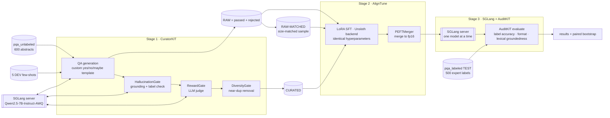
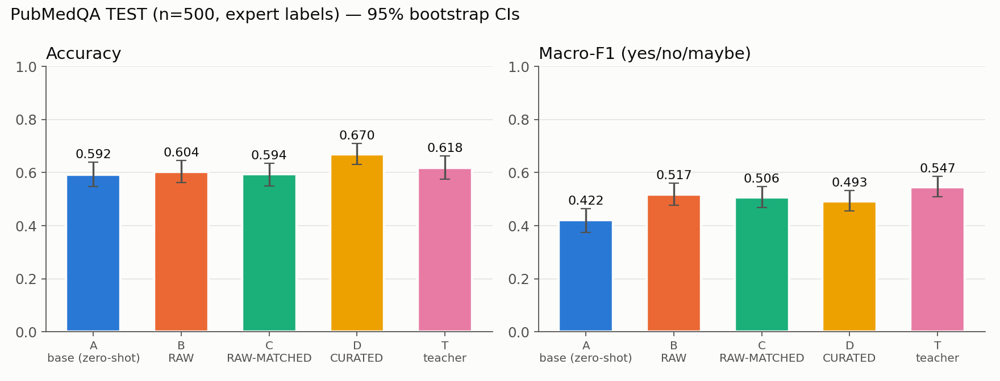
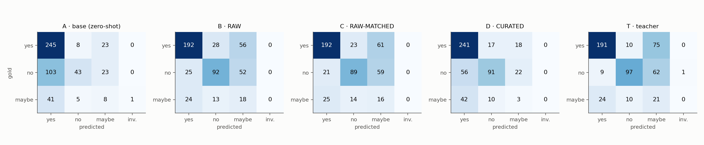
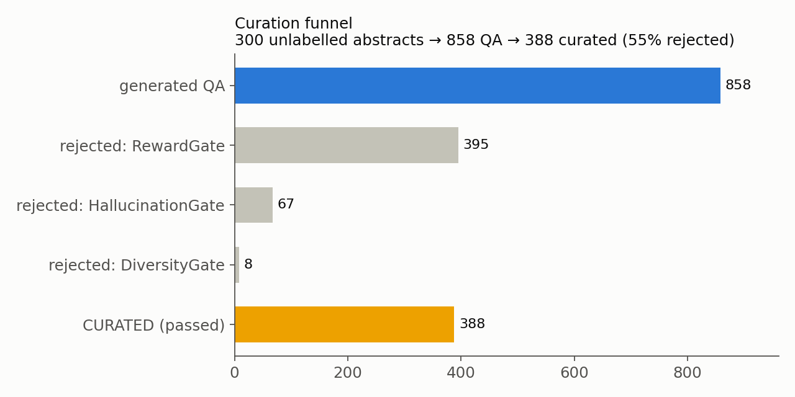
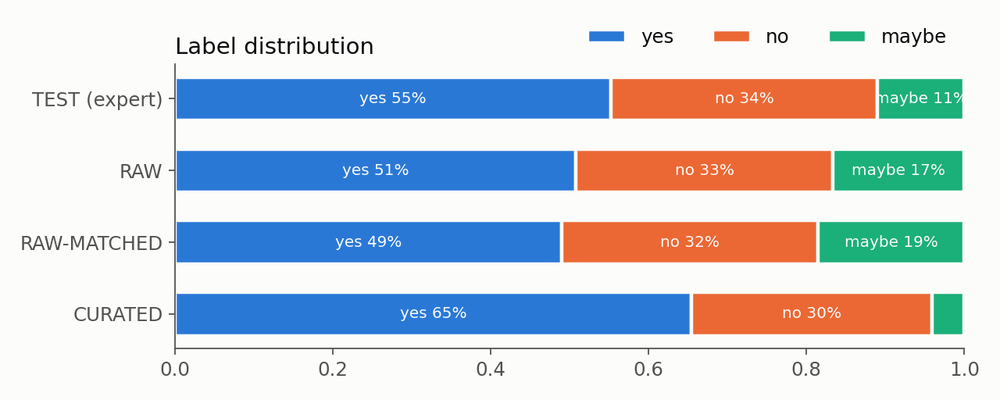

# MedCurate: curated synthetic data beats raw synthetic data on PubMedQA

**Syntax Error 2026 · Local LLM Track · Problem statement #8, "Data-scarce domains"**

**Demo video:** https://youtu.be/BcxwJX-dQ-U

> Where little real data exists, generate, verify and filter synthetic training data, and show that curation measurably beats training on raw generated data.

## Why it matters

Biomedical question answering needs expert labels, and those are scarce and expensive. **PubMedQA** has only **1,000 expert-labelled** yes/no/maybe questions, against 61k unlabelled abstracts. We use the unlabelled abstracts to generate synthetic training data with a local 7B model, filter it with Lexsi CuratorKIT, fine-tune a 1.5B student with AlignTune, and evaluate it on held-out expert labels with AuditKIT. Every model call goes through **SGLang**.

The question we test: does **curating** synthetic data beat training on the **raw** generated data, once dataset size is controlled for?

## Pipeline

## How each required tool is used

| Tool | Where | What it does here |
|---|---|---|
| **SGLang** 0.5.22 | every notebook that runs a model | All inference: the generator/judge for CuratorKIT (OpenAI-compatible `/v1`), zero-shot baselines A and T, the fine-tuned B/C/D, the `sglang.bench_serving` throughput test and the Gradio demo. It runs in its own venv as a background server (`src/ps8_common.py: start_server/stop_server`). |
| **CuratorKIT** 0.1.21 | `03_synthetic_generation_curatorkit` | `generation_task="qa"` with our yes/no/maybe prompt template. Gates: `HallucinationGate` (custom prompt that also checks the label), `RewardGate`, `DiversityGate`; MinHash dedup and cleaning on the sources. Native outputs (`manifest.json`, `rejected.jsonl`, `dataset_card.md`, `lexsi_provenance.json`, exports) are kept per chunk. |
| **AlignTune** 0.1.28 | `00`, `05` | `create_sft_trainer(..., backend="unsloth")` runs LoRA SFT for the three arms with identical settings. `aligntune.core.merge.PEFTMerger` merges each adapter so SGLang can serve it. |
| **AuditKIT** 1.1.3 | `02`, `06`, `07` | `ak.evaluate` with an SGLang-backed callable and three scorers: label accuracy, format validity, and `LexicalGroundedness` of the reasoning against the abstract. The paired significance tests use `auditkit._bootstrap.paired_bootstrap`. |

## Data and splits

| Split | Source | Size | Use |
|---|---|---|---|
| **TEST** | `pqa_labeled`, stratified, seed 42 | 500 (276 yes / 169 no / 55 maybe) | final evaluation only. Never shown to the generator and never trained on (`data/test_pubids.json`). |
| **DEV** | the other 500 of `pqa_labeled` | 500 | 5 few-shot examples for the generation prompt (`data/fewshot.json`) and the demo examples |
| **SOURCE** | `pqa_unlabeled`, random, seed 42 | 300 abstracts | input for synthetic generation. Zero pubid overlap with TEST and DEV (asserted). |

Every stage uses the same task format: a system prompt, then `Abstract: … Question: …`, and a target of 1–3 sentences of reasoning followed by `Answer: yes|no|maybe`. The parser takes the last `Answer:` line. Unparseable output counts as wrong and is reported separately as the format-failure rate.

## Experimental design

| ID | Training data | n |
|---|---|---|
| A | none (base `Qwen2.5-1.5B-Instruct`, zero-shot) | – |
| B | **RAW**: every generated QA (passed + rejected) | 858 |
| C | **RAW-MATCHED**: random sample of RAW the same size as CURATED (seed 42), the size control | 388 |
| D | **CURATED**: QA that passed all CuratorKIT gates | 388 |
| T | teacher/generator `Qwen2.5-7B-Instruct-AWQ`, zero-shot (reference) | – |

B, C and D share every hyperparameter: LoRA r=16, α=32, dropout 0.05 on all linear projections, lr 2e-4, cosine schedule, 3% warmup, 2 epochs, max length 1024, effective batch 16 (2 × 8 accumulation), seed 42. The same minimal format filter applies to every arm, and it dropped 0 rows. Evaluation uses temperature 0, `max_tokens=256`, and the same prompt and parser for every model.

## Results (500 expert-labelled TEST items)

| Model | Accuracy [95% CI] | Macro-F1 [95% CI] | F1 yes / no / maybe | Format fail | Lexical groundedness |
|---|---|---|---|---|---|
| A · base | 0.592 [0.548, 0.640] | 0.422 [0.374, 0.465] | 0.737 / 0.382 / 0.147 | 0.2% | 0.546 |
| B · RAW (858) | 0.604 [0.562, 0.646] | **0.517** [0.478, 0.560] | 0.743 / 0.609 / **0.199** | 0% | 0.780 |
| C · RAW-MATCHED (388) | 0.594 [0.550, 0.636] | 0.506 [0.468, 0.547] | 0.747 / 0.603 / 0.168 | 0% | 0.784 |
| **D · CURATED (388)** | **0.670** [0.630, 0.710] | 0.493 [0.455, 0.532] | **0.784 / 0.634** / 0.061 | 0% | **0.787** |
| T · teacher 7B-AWQ (ref.) | 0.618 [0.576, 0.662] | 0.547 [0.508, 0.586] | 0.764 / 0.678 / 0.197 | 0.2% | 0.685 |

**The 1.5B student trained on curated data beats its own 7B teacher on accuracy.** D scores 0.670 vs 0.618: right on 84 items where T is wrong, wrong on 58 where T is right (McNemar p = 0.036). The teacher stays ahead on macro-F1 (0.547), mostly because it handles "maybe" better.

**Paired tests on the same 500 items** (`results/significance.json`). Accuracy uses an exact McNemar test plus a paired-bootstrap 95% CI of the difference; macro-F1 uses a paired-bootstrap CI.

| Comparison | Δ accuracy [95% CI] | McNemar p | Δ macro-F1 [95% CI] |
|---|---|---|---|
| **D vs C** (curated vs size-matched raw) | **+7.6 pts [+3.6, +11.4]** | **0.0003** (73 vs 35 discordant) | −1.3 [−5.5, +2.6], n.s. |
| **D vs B** (curated vs 2.2× more raw) | **+6.6 pts [+2.4, +11.0]** | **0.003** (75 vs 42) | −2.4 [−6.9, +2.3], n.s. |
| D vs A | +7.8 pts [+4.0, +12.0] | 0.0001 | **+7.1 [+2.5, +12.6]** |
| C vs B | −1.0 [−5.0, +3.0] | 0.69 | −1.1 [−4.9, +2.7], n.s. |

### What this shows

- **Curation beats raw generated data on accuracy, and the gain comes from quality, not quantity.** D beats the size-matched control C by 7.6 points (p = 0.0003). It also beats B, which trained on 2.2× more data (p = 0.003). C and B are indistinguishable (p = 0.69), so the extra 470 raw samples added nothing.
- **Raw synthetic data teaches the student to hedge.** B and C predict "maybe" for 108 and 120 TEST items whose expert label is yes or no. Many of the generator's "maybe" answers were hedges on clear findings, and the gates rejected 127 of 143 of them. D is decisive and gets the most yes and no items right of any model, 332 in total, against 288 for A, 284 for B and 281 for C (see the confusion matrices).
- **On macro-F1, curation does not beat raw.** It ties (D vs C −1.3, CI includes 0). Removing most "maybe" answers left CURATED with only 4% maybe (TEST has 11%), and D's maybe-F1 fell to 0.06. Every fine-tuned model beats the base on macro-F1. This is our main limitation and the clearest next step: rebalance the curated set by label, or relax the threshold for "maybe" only.
- **Format compliance went from 99.8% to 100%** for all fine-tuned models, and lexical groundedness of the reasoning rose from 0.55 to about 0.78.

## Curation funnel

300 abstracts → **858** QA → **388 curated** (55% rejected).

| Gate | Rejected |
|---|---|
| RewardGate (LLM judge, ≥ 0.75) | 395 |
| HallucinationGate (grounding and label check, ≥ 0.80) | 67 |
| DiversityGate (near-duplicates, cosine > 0.92) | 8 |

Thresholds were tuned on a 30-abstract pilot (`data/pilot_runs.json`, DECISIONS G2).

| Set | n | yes / no / maybe | avg reasoning words |
|---|---|---|---|
| RAW | 858 | 51 / 33 / 17 % | 26.5 |
| RAW-MATCHED | 388 | 49 / 33 / 19 % | 27.1 |
| CURATED | 388 | 65 / 30 / 4 % | 29.6 |

### Bad synthetic samples the gates caught (`results/caught_examples.json`)

1. **Hedged label on a clear null result** (HallucinationGate, grounding 0.70).
   - *Q:* "Is positive emotional expression associated with greater improvement in pulmonary function than neutral expression in patients with asthma?"
   - *A:* The answer correctly copies the numbers (FEV1 +1.3% for positive writing vs +3.0% for control, "not statistically or clinically significant"), then concludes **`Answer: maybe`**.
   - *Why it's bad:* the positive-writing group improved *less* than control, with no significant difference. The supported answer is **no**. Training on this teaches the student to say "maybe" whenever a study is null, which is exactly the hedging we see in B and C.
2. **Reasoning that doesn't answer the question** (HallucinationGate, 0.70).
   - *Q:* "Does a pharmacoinvasive strategy increase the risk of cardiogenic shock and CHF in patients with **large** infarct size compared to PPCI?"
   - *A:* The answer discusses the proportion of PPCI patients with large infarcts and the *small*-infarct subgroup, then says `no`.
   - *Why it's bad:* the label happens to match the abstract ("no difference … in the other 2 groups"), but the reasoning never states the evidence for large infarcts. The student learns to reach a label through irrelevant facts.
3. **A misread statistic** (RewardGate, 0.70).
   - *Q:* "Is ROTEM effective in identifying patients who do **not** bleed more than 200 mL/h?"
   - *A:* "Maybe, while 94% of patients not bleeding … had at least one abnormal ROTEM result, it's unclear…"
   - *Why it's bad:* the abstract's key result is a **negative predictive value of 100%**: a normal ROTEM reliably rules out bleeding. The answer cites the 94% abnormal rate among non-bleeders, which is a specificity problem and not relevant to this question, and hedges.

**The gates are not perfect.** RewardGate also rejected (score 0.35) an EAS-10 construct-validity question answered `yes`, whose reasoning *is* supported by the abstract (all item loadings r > 0.30, one-dimensional structure). With one 7B model acting as both generator and judge, some good samples get filtered out too (see Limitations).

### Where D was right and B was wrong (`results/d_right_b_wrong.json`; D right / B wrong on 75 items, B right / D wrong on 42)

- *"Is withdrawal-induced anxiety in alcoholism based on beta-endorphin deficiency?"* (gold **yes**). B: "…did not establish a direct link…" → `no`. D: "…levels of beta-E were inversely correlated with anxiety. This suggests a potential link…" → `yes`.
- *"Quaternary cytoreductive surgery in ovarian cancer: does surgical effort still matter?"* (gold **yes**). B hedges → `maybe`. D cites "mean OS for patients without vs any tumour residuals was significantly higher" → `yes`.
- *"TEE in brain-dead donors: are marginally acceptable hearts suitable for transplantation?"* (gold **yes**). B → `maybe`. D → `yes`, citing the successful transplants of the hearts with FAC < 50%.

## Serving performance (model D on SGLang, Tesla T4)

`sglang.bench_serving`: 200 random prompts, 512 input / 128 output tokens, 32 concurrent, fp16, triton attention backend.

| Metric | Value |
|---|---|
| Throughput | **2.40 req/s · 307.5 output tok/s · 1,537.6 total tok/s** |
| End-to-end latency | p50 **13.1 s** · p95 **13.3 s** (32 concurrent requests) |
| Time to first token | p50 4.5 s · p95 8.3 s |
| Inter-token latency | p50 35.9 ms |
| TEST eval (500 items, 32 concurrent) | ~125–130 s per model |

## Limitations

- **Label skew introduced by curation.** The gates removed most "maybe" answers (CURATED is 4% maybe vs 11% in TEST), so D under-predicts "maybe" (F1 0.06) and only ties raw on macro-F1. Label-aware thresholds or resampling (CuratorKIT `resample` / `target_distribution`) are the obvious next step. We did not run that iteration within the deadline.
- **The generator is also the judge**, a single Qwen2.5-7B-AWQ, because only one 7B model fits on a T4. CuratorKIT recommends a separate judge. Self-leniency shows in the pilot: only 3/86 were rejected for grounding at 0.7. Some good samples are also rejected (see the EAS-10 example).
- **Small scale.** 300 abstracts → 858 QA, chosen for time on a T4 (DECISIONS G1). One seed per arm, so seed-to-seed variance of fine-tuning was not measured.
- **Loss is on the full sequence**, not assistant tokens only, because AlignTune's Unsloth path doesn't mask the prompt (DECISIONS F1). The setting is identical for all arms.
- **Single requests can differ slightly from batched eval output.** Greedy decoding in fp16 on a T4 is batch-dependent: the eval sent 32 requests at once, the demo sends one. We replayed 40 TEST items through the live demo one at a time. The labels agreed with the eval on 40/40 items for B and 39/40 for D, and 36–37/40 outputs were identical word for word.
- **Lexical groundedness** is a word-overlap proxy (AuditKIT `LexicalGroundedness`), not a claim-level faithfulness judge.
- **AuditKIT `paired_bootstrap` p-values are not centred under the null**, so they come out near 0.5 regardless of effect size. We report McNemar and bootstrap CIs instead (DECISIONS A1).

## Artifacts (Google Drive `MyDrive/ps8/`)

| Path | Contents |
|---|---|
| `artifacts/data/` | `test.jsonl`, `dev.jsonl`, `source_abstracts.jsonl` |
| `artifacts/curator/full/chunk_*/curatorkit/` | CuratorKIT native outputs (`manifest.json`, `rejected.jsonl`, `dataset_card.md`, `lexsi_provenance.json`, exports) |
| `artifacts/curator/full/chunk_*/{passed,rejected}.jsonl` | flat per-sample dumps with judge scores |
| `artifacts/train/{raw,raw_matched,curated}.jsonl` | the three training sets (messages format) |
| `artifacts/adapters/{B,C,D}/` | LoRA adapters |
| `artifacts/models/{B,C,D}_merged/` | merged fp16 models, served by SGLang |
| `artifacts/auditkit/run_*.json` | AuditKIT `RunResult`s |
| `repo/results/`, `repo/figures/`, `repo/data/` | mirrored in this repo |

## Reproduce

Hardware used: one **Tesla T4** (Colab). The pipeline also runs on L4 or A100; profiles are in `configs/experiment.yaml`.

1. Copy this repo to Google Drive at `MyDrive/ps8/repo` (or set `PS8_ROOT`). Large artifacts are written to `MyDrive/ps8/artifacts`.
2. Run the notebooks in order on a GPU Colab runtime. Each one is idempotent: it skips finished work unless `FORCE=True`.

| Notebook | Purpose | T4 runtime |
|---|---|---|
| `00_setup_env_and_smoke_test` | install, persistence check, tiny run of every stage | ~15 min fresh |
| `01_data_prep_pubmedqa` | TEST/DEV split, few-shots, 600 source abstracts | ~2 min |
| `02_baseline_eval_sglang_auditkit` | model A (and teacher T once 03 has picked it) | ~5 + 10 min |
| `03_synthetic_generation_curatorkit` | pilot, then full generation and curation | see results |
| `04_build_training_sets` | RAW / RAW-MATCHED / CURATED | <1 min |
| `05_finetune_aligntune` | train and merge B, C, D | see results |
| `06_eval_finetuned_sglang_auditkit` | eval B, C, D and benchmark serving | ~25 min |
| `07_analysis_figures` | tables, significance, figures, examples | ~2 min |
| `08_demo_gradio` | public demo, D next to B | ~3 min |

Pinned versions: `requirements-sglang.txt`, `requirements-pipeline.txt`, `requirements-train.txt`. Every deviation from the original plan is listed in [`DECISIONS.md`](DECISIONS.md).
