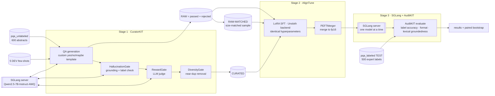

# MedCurate: curated synthetic data beats raw synthetic data on PubMedQA

**Syntax Error 2026 · Local LLM Track · Problem statement #8, "Data-scarce domains"**

> Where little real data exists, generate, verify and filter synthetic training data, and show that curation measurably beats training on raw generated data.

## Why it matters

Biomedical question answering needs expert labels, and those are scarce and expensive. **PubMedQA** has only **1,000 expert-labelled** yes/no/maybe questions, against 61k unlabelled abstracts. We use the unlabelled abstracts to generate synthetic training data with a local 7B model, filter it with Lexsi CuratorKIT, fine-tune a 1.5B student with AlignTune, and evaluate it on held-out expert labels with AuditKIT. Every model call goes through **SGLang**.

The question we test: does **curating** synthetic data beat training on the **raw** generated data, once dataset size is controlled for?

## Pipeline

## How each required tool is used

| Tool | Where | What it does here |
|---|---|---|
| **SGLang** 0.5.22 | every notebook that runs a model | All inference: the generator/judge for CuratorKIT (OpenAI-compatible `/v1`), zero-shot baselines A and T, the fine-tuned B/C/D, the `sglang.bench_serving` throughput test and the Gradio demo. It runs in its own venv as a background server (`src/ps8_common.py: start_server/stop_server`). |
| **CuratorKIT** 0.1.21 | `03_synthetic_generation_curatorkit` | `generation_task="qa"` with our yes/no/maybe prompt template. Gates: `HallucinationGate` (custom prompt that also checks the label), `RewardGate`, `DiversityGate`; MinHash dedup and cleaning on the sources. Native outputs (`manifest.json`, `rejected.jsonl`, `dataset_card.md`, `lexsi_provenance.json`, exports) are kept per chunk. |
| **AlignTune** 0.1.28 | `00`, `05` | `create_sft_trainer(..., backend="unsloth")` runs LoRA SFT for the three arms with identical settings. `aligntune.core.merge.PEFTMerger` merges each adapter so SGLang can serve it. |
| **AuditKIT** 1.1.3 | `02`, `06`, `07` | `ak.evaluate` with an SGLang-backed callable and three scorers: label accuracy, format validity, and `LexicalGroundedness` of the reasoning against the abstract. The paired significance tests use `auditkit._bootstrap.paired_bootstrap`. |

<!-- RESULTS -->

## Reproduce

Hardware used: one **Tesla T4** (Colab). The pipeline also runs on L4 or A100; profiles are in `configs/experiment.yaml`.

1. Copy this repo to Google Drive at `MyDrive/ps8/repo` (or set `PS8_ROOT`). Large artifacts are written to `MyDrive/ps8/artifacts`.
2. Run the notebooks in order on a GPU Colab runtime. Each one is idempotent: it skips finished work unless `FORCE=True`.

| Notebook | Purpose | T4 runtime |
|---|---|---|
| `00_setup_env_and_smoke_test` | install, persistence check, tiny run of every stage | ~15 min fresh |
| `01_data_prep_pubmedqa` | TEST/DEV split, few-shots, 600 source abstracts | ~2 min |
| `02_baseline_eval_sglang_auditkit` | model A (and teacher T once 03 has picked it) | ~5 + 10 min |
| `03_synthetic_generation_curatorkit` | pilot, then full generation and curation | see results |
| `04_build_training_sets` | RAW / RAW-MATCHED / CURATED | <1 min |
| `05_finetune_aligntune` | train and merge B, C, D | see results |
| `06_eval_finetuned_sglang_auditkit` | eval B, C, D and benchmark serving | ~25 min |
| `07_analysis_figures` | tables, significance, figures, examples | ~2 min |
| `08_demo_gradio` | public demo, D next to B | ~3 min |

Pinned versions: `requirements-sglang.txt`, `requirements-pipeline.txt`, `requirements-train.txt`. Every deviation from the original plan is listed in [`DECISIONS.md`](DECISIONS.md).
